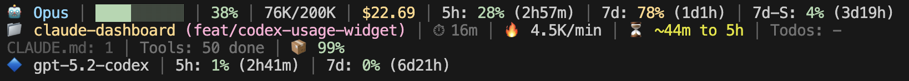

# claude-dashboard


Comprehensive status line plugin for Claude Code — unified usage monitoring across Claude, Codex, Gemini, Antigravity, and z.ai CLIs, with context, rate limits, cost tracking, and a modular widget system.

## Demo


## Installation

**Requirements:** Claude Code v1.0.80+ / Node.js 18+

### From Plugin Marketplace

```
/plugin marketplace add uppinote20/claude-dashboard
/plugin install claude-dashboard
/claude-dashboard:setup
```

### Manual Installation

```bash
git clone https://github.com/uppinote20/claude-dashboard.git "${CLAUDE_CONFIG_DIR:-$HOME/.claude}/plugins/claude-dashboard"
/claude-dashboard:setup
```

> `/claude-dashboard:setup` looks for the plugin under `plugins/cache/claude-dashboard/claude-dashboard/`,
> which a manual clone into `plugins/claude-dashboard/` does not match — the setup command's shim lookup
> will find nothing to copy. Point `statusLine.command` in `settings.json` directly at your clone's
> `dist/index.js` instead (e.g. `node "${CLAUDE_CONFIG_DIR:-$HOME/.claude}/plugins/claude-dashboard/dist/index.js"`),
> and note that manual installs do not get automatic version pickup — `git pull` and update the path
> yourself after each release.

## Display Modes

**Compact (1 line) - Default:**


> Model, context progress bar, cost, rate limits (5h/7d) or z.ai usage (mutually exclusive by provider)

**Normal (2 lines):**


> Adds project info, session ID, session duration, burn rate, todo progress

**Detailed (6 lines):**



> Adds depletion time, config counts, tool/agent status, cache hit, performance badge, token breakdown, forecast, budget, Codex/Gemini/Antigravity usage

Multi-provider support: z.ai/ZHIPU, Codex, Gemini, Antigravity auto-detected when installed.


## Widgets

| Category | Widget | Description |
|----------|--------|-------------|
| **Core** | `model` | Model name and version with emoji (e.g. `Opus 5.5`), effort level for Opus/Sonnet/Fable (MAX/X/H/M/L), fast mode for Opus (↯). Reads the live `effort.level` / `fast_mode` from stdin, falling back to `settings.json` on older Claude Code |
| | `context` | Progress bar, percentage, tokens (🟢 0-50% / 🟡 51-80% / 🔴 81-100%) |
| | `contextBar` | Progress bar only (sub-widget of `context`) |
| | `contextPercentage` | Percentage only (sub-widget of `context`) |
| | `contextUsage` | Token count only, e.g. `42K/200K` (sub-widget of `context`) |
| | `cost` | Session cost in USD |
| | `projectInfo` | Directory + git branch (clickable OSC8 link) + ahead/behind (↑↓), subpath from project_dir, worktree indicator (🌳) |
| **Rate Limits** | `rateLimit5h` | 5-hour rate limit with reset countdown |
| | `rateLimit7d` | 7-day rate limit (Pro and Max) |
| | `rateLimit7dSonnet` | 7-day Sonnet limit (Max only) — deprecated ~2026-06: Anthropic merged it into the unified weekly bucket at the Sonnet 5 launch, so the API returns `null` and the widget stays hidden until/unless the field returns |
| | `rateLimit7dFable` | 7-day Fable limit (Max only) |
| **Session** | `sessionId` | Session ID (short 8-char) |
| | `sessionIdFull` | Session ID (full UUID) |
| | `sessionName` | Session name from /rename command |
| | `sessionDuration` | Session duration |
| | `lastPrompt` | Last user prompt with timestamp |
| | `configCounts` | CLAUDE.md, AGENTS.md, rules, MCPs, hooks, +Dirs |
| **Activity** | `toolActivity` | Running/completed tools with targets (e.g., `Read(app.ts)`) |
| | `agentStatus` | Subagent progress with resolved model, e.g. `Explore(Opus)` (from the Agent tool's `model` param or `CLAUDE_CODE_SUBAGENT_MODEL`) |
| | `todoProgress` | Todo completion rate |
| **Analytics** | `burnRate` | Token consumption per minute, session average (input + cache write + output) |
| | `cacheHit` | Cache hit rate percentage (last request) |
| | `promptCache` | Session prompt-cache health: ♨️ warm with time left before it goes cold / ❄️ cold, hit ratio, miss count, e.g. `♨️ 4m 91% miss 2` (from `prompt_cache`, Claude Code ≥ 2.1.251). The warm→cold switch happens on its own; set `statusLine.refreshInterval` (e.g. `60`) to keep the minute countdown ticking while idle |
| | `promptCacheState` | Warm/cold icon + time left only, e.g. `♨️ 4m` (sub-widget of `promptCache`) |
| | `promptCacheHit` | Session cache hit ratio only, e.g. `91%` (sub-widget of `promptCache`) |
| | `promptCacheMisses` | Miss count only, e.g. `miss 2`; hidden at 0 (sub-widget of `promptCache`) |
| | `depletionTime` | Estimated time to rate limit (approx)¹ |
| **Multi-CLI** | `codexUsage` | OpenAI Codex CLI usage (auto-hide if not installed)² |
| | `geminiUsage` | Google Gemini CLI - current model (auto-hide if not installed)³ |
| | `geminiUsageAll` | Google Gemini CLI - all models (auto-hide if not installed)³ |
| | `antigravityUsage` | Google Antigravity CLI - weekly quota by model family (auto-hide if not installed)⁸ |
| | `antigravityUsageAll` | Google Antigravity CLI - per-model quota (auto-hide if not installed)⁸ |
| | `zaiUsage` | z.ai/ZHIPU usage (auto-hide if not using z.ai)⁴ |
| **Insights** | `tokenBreakdown` | Input/output/cache write/read token breakdown |
| | `performance` | Composite efficiency badge (cache hit + output ratio) |
| | `forecast` | Estimated hourly cost based on session rate |
| | `budget` | Daily spending vs configured budget limit⁵ |
| | `tokenSpeed` | Output token generation speed (tok/s), session average |
| | `tokenSpeedLast` | Output token generation speed of the most recent response only |
| | `todayCost` | Total spending across all sessions today |
| **Status** | `peakHours` | Peak hours indicator with countdown ([based on PeakClaude](https://github.com/pforret/PeakClaude))⁶ |
| | `tagStatus` | Commits ahead of matched git tags (default pattern `v*`, customize via `tagPatterns`)⁷ |
| | `slashCommand` | Active slash command for the current turn (🎯), cleared by next plain-text message |
| | `agentMode` | Session agent identity: 👤 custom agent (via `/agent <name>`) or 🤖 subagent type |
| **Info** | `linesChanged` | Uncommitted lines added/removed, including untracked files (+N -N) |
| | `outputStyle` | Current output style (hidden when "default") |
| | `version` | Claude Code version display |
| | `vimMode` | Vim mode (NORMAL/INSERT), auto-hides when vim disabled |
| | `apiDuration` | API time as % of total session time |

> ¹ Assumes all utilization came from this session; improves as session runs longer.
> ² Auto-hides if `~/.codex/auth.json` not found. ³ Auto-hides if `~/.gemini/oauth_creds.json` not found — Gemini CLI personal tiers were retired 2026-06-18 in favor of Antigravity CLI (enterprise still supported). ⁴ Auto-hides if not detected via `ANTHROPIC_BASE_URL`. ⁵ Requires `"dailyBudget"` in config. ⁶ Peak = weekdays 5-11 AM PT; shows countdown to next transition. ⁷ Uses `tagPatterns` config (default `["v*"]`); auto-hides when no pattern matches a reachable tag. ⁸ Auto-hides if `~/.gemini/antigravity-cli/antigravity-oauth-token` not found.

i18n: English and Korean supported (auto-detect or set via setup).

## Configuration

```bash
# Preset modes
/claude-dashboard:setup compact             # 1 line (default)
/claude-dashboard:setup normal en pro       # 2 lines, English, Pro plan
/claude-dashboard:setup detailed ko max     # 6 lines, Korean, Max plan

# Custom mode: control widget order and line composition
# Format: "widget1,widget2,...|widget3,widget4,..." (| separates lines)
/claude-dashboard:setup custom auto max "model,context,cost|projectInfo,todoProgress"
```

**Plan differences:**

| Feature | Max | Pro |
|---------|-----|-----|
| 5h rate limit + countdown | ✅ | ✅ |
| 7d all models | ✅ | ❌ |

<details>
<summary><strong>Advanced Configuration</strong></summary>

**Interactive Mode:** Run `/claude-dashboard:setup` without arguments. Best for preset selection; for full widget control, use Direct Mode or edit the JSON file directly.

**Display Mode Presets** (`zaiUsage` and `rateLimit*` are mutually exclusive based on provider):

| Mode | Lines | Widgets |
|------|-------|---------|
| `compact` | 1 | model, context, cost, rateLimit5h/7d/7dSonnet, zaiUsage |
| `normal` | 2 | + projectInfo, sessionId, sessionDuration, burnRate, todoProgress |
| `detailed` | 6 | + depletionTime, configCounts, toolActivity, agentStatus, cacheHit, promptCache, performance, tokenBreakdown, forecast, budget, codexUsage, geminiUsage, antigravityUsage, linesChanged, outputStyle, version, peakHours, lastPrompt, vimMode, apiDuration, tagStatus |

**Configuration file** (`~/.claude/claude-dashboard.local.json`):

```json
{
  "language": "auto",
  "plan": "max",
  "displayMode": "custom",
  "lines": [
    ["model", "context", "cost", "rateLimit5h"],
    ["projectInfo", "todoProgress"]
  ],
  "theme": "default",
  "separator": "pipe",
  "dailyBudget": 15,
  "disabledWidgets": [],
  "modPane": "detailed",
  "modBand": "MC$R|BDO",
  "modBandDefault": false,
  "cache": { "ttlSeconds": 60 }
}
```

Or use preset shorthand for quick configuration:
```json
{
  "preset": "MC$R|BDO",
  "theme": "tokyoNight",
  "separator": "dot"
}
```

**Themes:** `default` (pastel) / `minimal` (monochrome) / `catppuccin` / `catppuccinLatte` (light-mode) / `dracula` / `gruvbox` / `nord` / `tokyoNight` / `solarized`

**Separators:** `pipe` (│, default) / `space` / `dot` (·) / `arrow` (›)

**Preset Shortcuts:** Quick layout with single characters — `"preset": "MC$R|BDO"` (M=model, C=context, $=cost, R=rateLimit5h, etc.)

**Budget Tracking:** Set `"dailyBudget": 15` to track daily spending. Shows ⚠️ at 80% and 🚨 at 95%.

**Tag Status:** Customize `tagStatus` patterns via `"tagPatterns": ["v*", "release-*"]`. Default is `["v*"]`. The widget auto-hides when no pattern matches a reachable tag.

**Widget Toggle:** Add widget IDs to `disabledWidgets` to hide them from any display mode.

**Mod Layouts:** `modPane` (the `/claude-dashboard-pane` pane, default `detailed`) and `modBand` (the `/claude-dashboard-band` band, default = your status line layout) take a display mode name (`compact` / `normal` / `detailed`), a preset string like `"MC$R|BDO"`, or custom widget lines like `[["model","context"],["sessionIdFull"]]` (same as the status line's `lines`). Set `"modBandDefault": true` to turn the band on at session start. See [Mods](#mods-pane--band).

**Color Legend:** 🟢 0-50% Safe / 🟡 51-80% Warning / 🔴 81-100% Critical

</details>

## Commands

### `/claude-dashboard:setup`

Configure the status line display mode, language, and plan. See [Configuration](#configuration).

### `/claude-dashboard:check-usage`

Check usage limits for all AI CLIs (Claude, Codex, Gemini, Antigravity, z.ai) at once and get a recommendation for which CLI has the most available capacity.

```bash
/claude-dashboard:check-usage              # Interactive output with colors
/claude-dashboard:check-usage --json       # JSON output for scripting
/claude-dashboard:check-usage --lang ko    # Specify language
```


### `/claude-dashboard:setup-alias`

Add a `check-ai` shell alias to quickly check all AI CLI usage from your terminal. Supports macOS/Linux (zsh/bash) and Windows (PowerShell).

```bash
/claude-dashboard:setup-alias
```

After setup:
```bash
check-ai          # Pretty output
check-ai --json   # JSON output for scripting
```

### `/claude-dashboard:update`

Repair or verify the statusLine shim. Usually unnecessary — after `/plugin update`, the
status line picks up the new version on its own. Use this if you have hooks disabled or the
status line stops updating.

```bash
/claude-dashboard:update
```

## Mods (pane & band)

claude-dashboard also ships as a Claude Code **mod** (function-hook plugin, early access, tested on Claude Code 2.1.289). It is bundled in the same plugin (`hooks/hooks.json` → `"modules": ["../dist/mod.js"]`), so there is nothing extra to install. Mods are drawn only in the terminal and the desktop Code tab (not the VS Code panel, not `claude -p`).

| Command | What it does |
|---------|--------------|
| `/claude-dashboard-pane [on\|off\|dashboard\|turns\|agents\|files\|todos\|errors\|bg]` | Open or close a pane beside the transcript (no argument flips it, keeping the last view). A view name opens the pane on that view, or switches an open pane in place. Default view `dashboard` uses the `modPane` layout (default `detailed`). |
| `/claude-dashboard-band [on\|off]` | Draw the dashboard above the prompt and hide the status line for **this session only** (`settings.json` is untouched). Layout from `modBand` (default = your status line layout). |

**Pane views** (`/claude-dashboard-pane <view>`):

The pane has a tab bar (`1: Dash  2: Turns  3: Agents  4: Files  5: Todos  6: Errors  7: Bg`): click a tab, or focus the pane (click it or `ctrl+x tab`) and press its digit, or move with Tab / arrows and press Enter. Esc returns to the prompt. `/claude-dashboard-pane <view>` switches the same way from the prompt.

| View | Shows |
|------|-------|
| `dashboard` | The widget layout from `modPane` (default view; refreshes every 60s) |
| `turns` | One line per user prompt, newest first (last 20): `#N HH:MM prompt elapsed ↑in ↓out 🔧tools 🤖agents`, with a per-turn token sparkline in the header. Slash commands show as `/name args`, shell input as `!cmd`; skill bodies, task notifications and command output are excluded. Tokens only, no $ |
| `agents` | Subagents of this session (20 most recently active): type, real model, description, elapsed, tool count, current running tool. Running first, `✓` done, `? stale` = running but no transcript write for 10 min |
| `files` | Files written by Edit/Write/MultiEdit/NotebookEdit this session (successful results only, main thread + subagents): project-relative path, count, source (`main`, `+N agents`). Up to 30 |
| `todos` | Full TodoWrite / Tasks list with ✓ / ▶ / ○ |
| `errors` | Failed tool calls, newest first (15): time, `tool(target)`, first error line; 🚫 for permission denials and blocks |
| `bg` | `run_in_background` Bash jobs and async agents, from launch to completion notice; running first, `? stale` when the session has been idle 10 min with no completion notice |

The selected view is kept for the session only (a new session starts on `dashboard`). Non-dashboard views refresh every 10s and on each session measure. Not included: agent teams/teammates, the desktop app plan tool, per-turn $ cost, click-to-jump.

```json
{
  "modPane": "detailed",
  "modBand": "MC$R|BDO",
  "modBandDefault": true
}
```

- `modPane` / `modBand` accept a display mode name (`compact` / `normal` / `detailed`), a preset string, or custom widget lines (`[["model","context"],["sessionIdFull"]]`). Unknown widget ids are dropped; if nothing is left, the default is used. `modBandDefault: true` turns the band on at session start.
- Interactive `/claude-dashboard:setup` asks how you want to use the mod dashboard (status line only, peek with pane, replace with band, or both) and writes these keys; rerunning setup keeps keys it does not ask about.
- **How hiding works:** the band writes a per-session heartbeat marker (`~/.cache/claude-dashboard/band-<sessionId>`), refreshed on every render (at most every 60s) and ignored after 180s. It is deleted on `off` and at session end, so if the mod stops the status line comes back by itself within 3 minutes.
- Theme, language, and `disabledWidgets` follow your normal config. `cacheHit`, `tokenBreakdown`, and `performance` are hidden in the pane and band (the mod API has no per-request cache usage).
- Data comes from the mod API (context, rate limits, and cost pushed by Claude Code) and the unchanged renderer `dist/index.js`, run as a subprocess.

## Troubleshooting

<details>
<summary><strong>Status line not showing</strong></summary>

1. Check if plugin is installed: `/plugin list`
2. Verify `settings.json` has a `statusLine` entry pointing at
   `plugins/data/claude-dashboard-claude-dashboard/statusline.mjs`
3. If it's still not showing, try restarting Claude Code

</details>

<details>
<summary><strong>Rate limits showing ⚠️</strong></summary>

- API token may be expired - re-login to Claude Code
- Network issue - check internet connection
- API rate limited - wait for the cache to refresh (`cache.ttlSeconds`, default 300 seconds)

</details>

<details>
<summary><strong>Multiple accounts (CLAUDE_CONFIG_DIR)</strong></summary>

Claude Code relocates its whole config directory — credentials, settings, and history — when `CLAUDE_CONFIG_DIR` is set. That is how two accounts run side by side:

```bash
# Personal Max account, kept separate from the default ~/.claude
CLAUDE_CONFIG_DIR=~/.claude-max claude
```

The status line follows the same variable, so each session reports the account that is actually rendering it. Leave it unset and the default `~/.claude` is used, as before.

Notes:

- The variable must be a single directory path, and must be exported to the session.
- On macOS the OAuth token comes from the Keychain, which holds one entry for all accounts — `CLAUDE_CONFIG_DIR` separates `settings.json` and `history.jsonl` reads, but rate-limit API calls use whichever OAuth token the Keychain holds.
- `/claude-dashboard:setup` and `/claude-dashboard:update` register the status line into the session's config dir (`$CLAUDE_CONFIG_DIR` if set, `~/.claude` otherwise) — run them once per account. The dashboard's own display config `~/.claude/claude-dashboard.local.json` is intentionally shared across accounts.

</details>

<details>
<summary><strong>Wrong language</strong></summary>

Run setup with explicit language:

```
/claude-dashboard:setup normal ko  # Korean
/claude-dashboard:setup normal en  # English
```

</details>

<details>
<summary><strong>Cache issues</strong></summary>

API response cache is stored in `~/.cache/claude-dashboard/`. To clear:

```bash
rm -rf ~/.cache/claude-dashboard/
```

Cache files are automatically cleaned up after 1 hour.

</details>

## Development

```bash
npm install && npm run build
```

See [CONTRIBUTING.md](CONTRIBUTING.md) for details.

## Star History

[](https://star-history.dera.page/#uppinote20/claude-dashboard&Date)

## ☕ Support

If you find this plugin useful, support development:

<div style="display: flex; gap: 20px; align-items: center;">
  <a href="https://ko-fi.com/uppinote" target="_blank">
    
  </a>
  <a href="https://www.buymeacoffee.com/uppinote" target="_blank">
    
  </a>
</div>

## License

MIT
